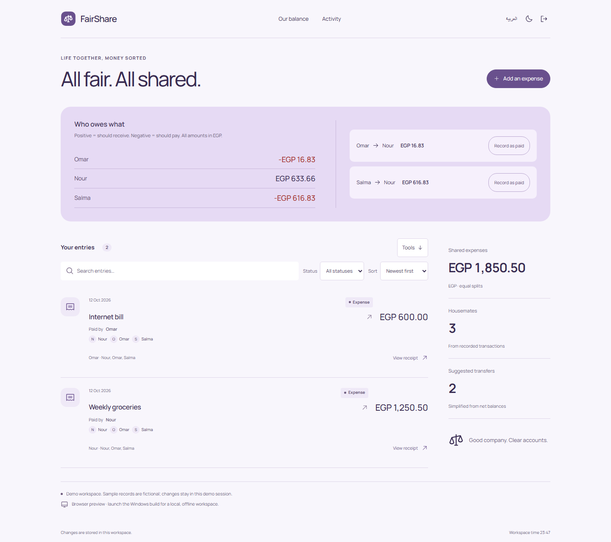
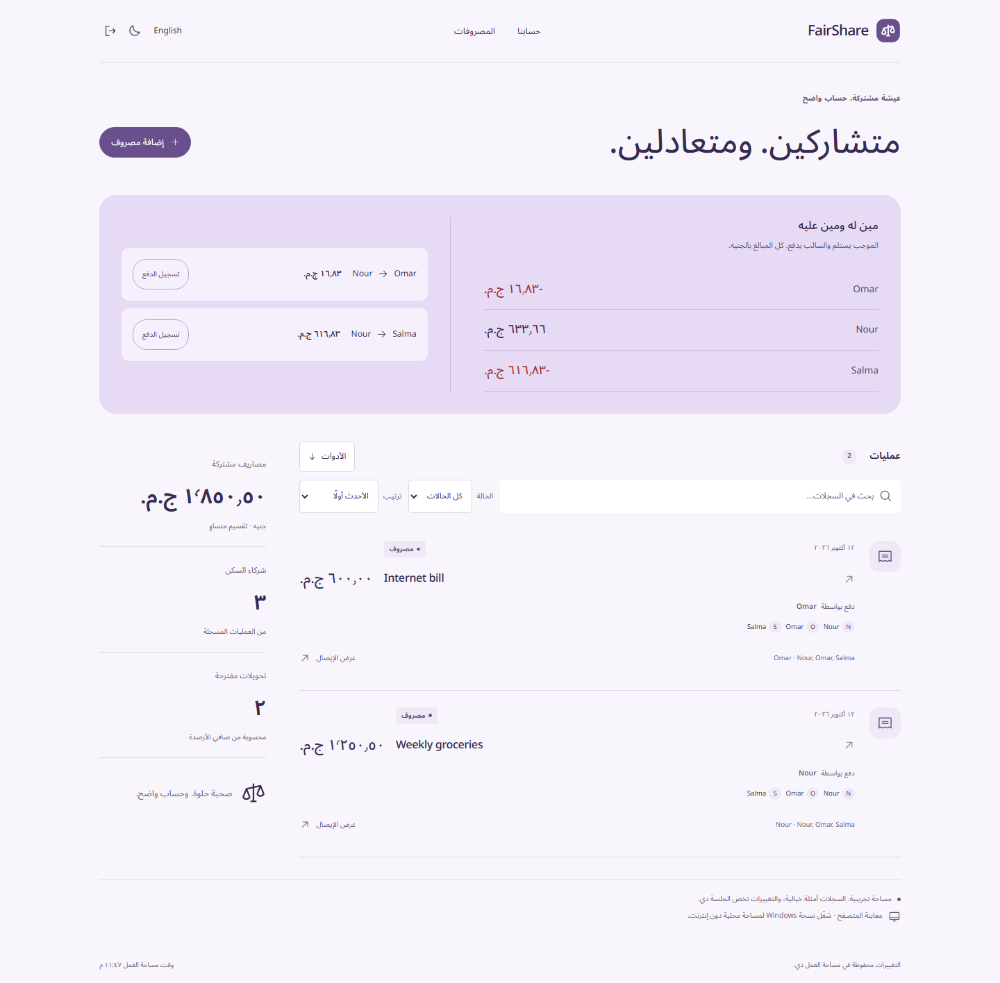
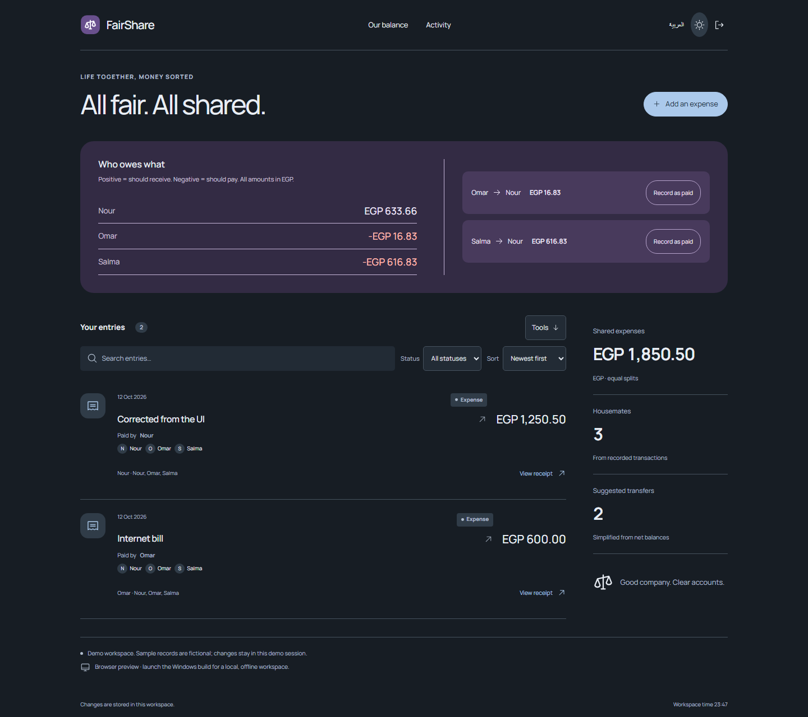

# FairShare

### Shared expenses, without the mental arithmetic.

For housemates keeping a shared expense record on one Windows computer.

**[Download for Windows](https://github.com/Ahmed-Khalil-Mohamed/fairshare/releases/latest)** · [العربية](#بالعربي) · [Report a bug](https://github.com/Ahmed-Khalil-Mohamed/fairshare/issues/new?template=bug_report.yml) · [Suggest an improvement](https://github.com/Ahmed-Khalil-Mohamed/fairshare/issues/new?template=feature_request.yml)



> Record an expense, inspect the split, then record a settlement after money has actually changed hands.

[](https://github.com/Ahmed-Khalil-Mohamed/fairshare/actions/workflows/quality.yml) [](LICENSE) 

## Get the Windows app

Download **[FairShare-1.1.0-windows-x64.zip](https://github.com/Ahmed-Khalil-Mohamed/fairshare/releases/download/v1.1.0/FairShare-1.1.0-windows-x64.zip)**, extract the entire folder, and open `FairShare\FairShare.exe`. Keep the accompanying files next to the executable. Node.js is bundled; installing Node is only necessary for development.

[SHA256SUMS.txt](https://github.com/Ahmed-Khalil-Mohamed/fairshare/releases/download/v1.1.0/SHA256SUMS.txt) is supplied with the release. This is an **unsigned portable Windows x64 build**, tested on the development Windows machine; compatibility with every Windows configuration is not certified. There is no installer or automatic updater. Data stays in `%APPDATA%\FairShare\workspace.sqlite`, separately from the browser preview. Copying the app folder does not copy that database.

GitHub's automatic source archives contain the complete development source; use the Windows ZIP to run the packaged application.

## From one receipt to everyone’s share

1. Enter an expense, the payer and comma-separated participants using consistent names.
2. Inspect each person’s exact share and net balance.
3. After an actual transfer occurs, record the suggested settlement and watch balances update.

## How the records stay consistent

- Remainder cents are assigned deterministically in participant order, conserving the total.
- Balances use a null-prototype map so special names do not mutate object prototypes.
- Suggested transfers use greedy net settlement; no claim of globally minimum transfer count is made.
- A suggested settlement must still match current balances when saved.

## More of the interface

<details>
<summary>Arabic workspace / الواجهة العربية</summary>



</details>

<details>
<summary>Dark workspace</summary>



</details>

Soft violet balances above a transaction timeline, participant initials, quiet monetary typography and a narrow summary column. Settlement commands stay next to the actual proposed transfers.

Screenshots show the actual interface with fictional demonstration records. [Design notes](DESIGN.md) · [Image and icon provenance](ASSETS.md).

## Build the desktop app

Use **Node.js 24 or newer** and npm.

```sh
git clone https://github.com/Ahmed-Khalil-Mohamed/fairshare.git
cd fairshare
npm ci
npm run build
npm run desktop
```

Package with `npm run package:windows`; the complete output is `release/FairShare/`. The first launch or packaging step downloads the pinned Electron runtime, unless already cached. The packaged app runs offline.

Each checkout owns its dependency lockfile, server, tests and SQLite storage. The browser process uses `data/fairshare.sqlite` and the `fairshare_session` cookie. [Deployment and backups](docs/DEPLOYMENT.md).

## Checks you can run

```sh
npm run format:check
npm run check
npx playwright install chromium
npm run test:e2e
npm audit
```

300 exact-cent split cases, zero-sum balances, complete settlement, special participant names, stale-settlement rejection and browser recording. Local project results are in [VERIFICATION](docs/VERIFICATION.md).

The [Quality workflow](https://github.com/Ahmed-Khalil-Mohamed/fairshare/actions/workflows/quality.yml) runs on Windows and Linux. The badge above reports the live result. Local evidence, test counts and known validation limits are documented in [VERIFICATION](docs/VERIFICATION.md). Windows CI also packages the application and runs the native smoke check.

## Current boundaries

One currency (EGP), equal splits only, and names as identity. No bank connection, payment initiation, exchange rates, or shared cloud household.

The sample records are fictional. Interview intended users and measure task completion before claiming proven impact. A useful next study is to compare the complete workflow with the person’s current spreadsheet or paper process.

## بالعربي

تقسيم مصاريف السكن بدقة للقرش ومعرفة مين يدفع لمين، دون حسابات أو إنترنت على Windows.

بدّل اللغة من زر «العربية». البيانات التجريبية أمثلة وليست سجلات مستخدمين حقيقيين. [دليل التشغيل بالعربي](START-HERE-AR.md).

## Contribute and report

Use the [bug report](https://github.com/Ahmed-Khalil-Mohamed/fairshare/issues/new?template=bug_report.yml) for a reproducible problem, or the [feature request](https://github.com/Ahmed-Khalil-Mohamed/fairshare/issues/new?template=feature_request.yml) to explain a missing workflow. Reports in Arabic and English are welcome. Include the version, expected result and steps; use fictional records and redact personal data.

[Contribution guide](CONTRIBUTING.md) · [Private security reporting](SECURITY.md) · [Changelog](CHANGELOG.md) · [API](docs/API.md) · [Architecture](docs/ARCHITECTURE.md)

## License

[MIT](LICENSE). Third-party packages, fonts and icons retain their own licenses; see [THIRD-PARTY-NOTICES](THIRD-PARTY-NOTICES.md).
